  

# 🛠️ Awesome Developer Utilities & Menu Bar Tools

  
  
  
  
  

---

## 🧭 Executive Summary & SEO Overview

Welcome to the definitive **Developer Utilities & Menu Bar Tools** curated ecosystem. This repository indexes the top SaaS platforms, desktop productivity utilities, and open-source GitHub projects designed to accelerate engineer workflows across **macOS**, **Linux**, and **Windows**. 

Whether you are configuring a keyboard-driven application launcher, optimizing macOS menu bar real estate, automating text expansion, managing multi-window tiling layouts, or monitoring real-time system performance sensors, this guide delivers thoroughly vetted solutions categorized by capability, pricing transparency, company footprint, and open-source community traction.

---

## 📑 Table of Contents

- [📊 Sector Overview & Market Dynamics](#-sector-overview--market-dynamics)
- [💼 Commercial & SaaS Platforms](#-commercial--saas-platforms)
- [⭐ Open-Source GitHub Projects](#-open-source-github-projects)
- [🤝 How to Contribute](#-how-to-contribute)
- [☕ Support & Sponsorship](#-support--sponsorship)
- [📈 Star History](#-star-history)
- [⚠️ Disclaimer](#️-disclaimer)

---

## 📊 Sector Overview & Market Dynamics

The global desktop utilities software sector is currently estimated at **$8.4 Billion** and is projected to surpass **$11 Billion** by 2030, driven by the expanding hybrid workforce, local AI copilot interfaces, and developer workstation optimization. 

The market dynamics are **highly fragmented** rather than concentrated around a single winner-take-all monopoly: low barriers to building native micro-interfaces (via AppKit, Swift, Rust, and WinUI), niche operating system integration hooks, and strong developer demand for single-purpose, lightweight tools prevent monolithic suites from capturing the entire utility stack. Power users, engineers, and digital creators consistently assemble personalized multi-vendor setups combining indie SaaS subscriptions and open-source components.

---

## 💼 Commercial & SaaS Platforms

The table below catalogs premier commercial desktop utilities and SaaS platforms. Entries are sorted descending by company size, valuation, and annual recurring revenue (ARR).

| Product 🏷️ | Primary Category 🧩 | Company Size / Valuation / Revenue 🏢 | Pricing (Starting Tier) 💳 | Free Tier / Free Trial Limits ⏳ | Key Capabilities & Developer Value ⚡ |
| :--- | :--- | :--- | :--- | :--- | :--- |
| **[Raycast](https://raycast.com)** | Extensible Launcher & Command Palette | ~$100M–$250M Est. Valuation ($47.8M Series B Funded) | $10.00/month ($96/year billed annually) for Pro | Free Forever: Unlimited launcher & extensions; 3-month clipboard history limit; 5 quick notes; no cloud sync or native AI credits | Blazing-fast keyboard launcher with thousands of TypeScript extensions, floating notes, window management, and custom scripts for macOS and Windows. |
| **[CleanMyMac](https://macpaw.com)** | System Maintenance & Menu Bar Monitor | ~$90M Annual Revenue (MacPaw Flagship ~80% share) | $39.95/year (or $9.95/month, $119.95 one-time) for 1 Mac | 7-day fully functional free trial (requires registration; automatic conversion unless cancelled) | Complete macOS system optimizer, real-time background malware monitoring, disk space visualizer, and menu bar health telemetry. |
| **[Setapp](https://setapp.com)** | Curated Mac/iOS App Subscription Suite | ~$90M Annual Parent Revenue (MacPaw ~15% share; ~$13.5M ARR) | $14.99/month ($107.88/year billed annually) for 1 Mac | 7-day free trial granting full access to 240+ curated desktop apps and AI gateway | Subscription service providing unified, fully-licensed access to over 240 top macOS utility, menu bar, developer, and productivity apps. |
| **[TextExpander](https://textexpander.com)** | Cloud-Synced Snippets & Text Expansion | Established Indie Firm (~$5M–$10M Est. ARR, Smile Software) | $4.16/month ($49.92/year billed annually) for Individual Pro | 30-day Enterprise-featured free trial (no credit card required; automatically downgrades to Free Forever plan capped at 5 active snippets) | Cross-platform text expansion and macro automation platform facilitating rich team snippet repositories, dynamic forms, and script automation. |
| **[Hazel](https://noodlesoft.com)** | Automated File Management & Rule Engine | Established Bootstrapped Indie Studio (~$2M–$5M Est. Revenue, Noodlesoft) | $42.00 one-time purchase (Single User license) | 14-day fully functional free trial with unrestricted rule creation and automated actions | Headless macOS background folder-monitoring engine executing rule-based sorting, renaming, batch metadata matching, and AppleScript/shell triggers. |
| **[Magnet](https://crowdcafe.com)** | Window Management & Screen Tiling | Top Mac App Store Utility (~$2M–$5M Est. Lifetime Sales, CrowdCafe) | $4.99 one-time purchase (Perpetual license) | 0-day free trial (paid direct purchase on Mac App Store with 14-day standard Apple refund policy) | Lightweight, zero-configuration macOS window manager supporting keyboard shortcuts and intuitive edge dragging for halves, thirds, and quarters. |
| **[Alfred (Powerpack)](https://alfredapp.com)** | Productivity Launcher & Workflow Automation | Bootstrapped Indie Leader (~$1M–$3M Est. ARR, Running with Crayons) | £34.00 (~$43.00) one-time purchase for Single User License | Free Forever: Core app launcher, web search, calculator, system commands; Workflows, Clipboard History, and Snippets require Powerpack | Legendary macOS productivity command center featuring scriptable visual workflows, custom hotkeys, clipboard history, and system control. |
| **[Bartender](https://macbartender.com)** | Menu Bar Icon Management & Notch Organizer | Acquired Indie Product (~$1M–$3M Est. ARR, Applause / Surtees Studios) | $20.00 one-time purchase (or Bartender Pro yearly subscription) | 4-week (28 days) unrestricted free trial (no credit card required; prompts for license key upon expiration) | Industry-standard menu bar organizer allowing users to hide, reveal, search, and dynamically trigger menu bar icons based on system status. |
| **[PopClip](https://popclip.app)** | Contextual Text Selection Action Menu | Independent Software Studio (~$500K–$1M Est. Lifetime, Pilotmoon) | $19.00 one-time purchase (Personal License for up to 5 Macs) | 250-action free trial limit (unrestricted features; displays purchase reminder after 250 text selections; free hardship licenses on request) | Contextual quick-action toolbar that appears whenever text is highlighted on macOS, offering instant transformations, web lookup, and custom extensions. |
| **[Dropzone](https://aptonic.com)** | Menu Bar Drag-and-Drop Action Hub | Bootstrapped Indie Studio (~$300K–$700K Est. Lifetime, Aptonic) | $4.99/month for Dropzone Pro (or ~$35.00 one-time lifetime license) | 14-day Pro free trial with full action suite; base version remains Free Forever for standard file drag-and-drop storage | Rapid drag-and-drop shelf living in the macOS menu bar providing instant file uploads, cloud targets, image conversions, and custom script actions. |

---

## ⭐ Open-Source GitHub Projects

Explore the finest open-source developer utilities and menu bar applications. Every project features a live GitHub Stars_Badge linking directly to its stargazer community, sorted descending by GitHub Stars_Count.

| Repository & Stargazers 🌟 | Platform / Stack 💻 | Description & Key Features 🚀 |
| :--- | :--- | :--- |
| **[tw93/Mole](https://github.com/tw93/Mole)**    | macOS / Linux / Windows • Shell | Clean, lightweight desktop system cleaner removing caches, build logs, and orphaned development packages without bloat. |
| **[exelban/stats](https://github.com/exelban/stats)**    | macOS • Swift | Comprehensive macOS menu bar system telemetry monitor tracking CPU, GPU, memory, disks, network throughput, battery, and fan speeds in real-time. |
| **[MonitorControl/MonitorControl](https://github.com/MonitorControl/MonitorControl)**   [ | macOS • Swift | Native menu bar utility controlling external monitor DDC/CI hardware brightness, contrast, and audio volume using Apple keyboard media keys. |
| **[rxhanson/Rectangle](https://github.com/rxhanson/Rectangle)**    | macOS • Swift | Blazing-fast keyboard-driven window management and snap-area tool for tiling and organizing application windows effortlessly. |
| **[jordanbaird/Ice](https://github.com/jordanbaird/Ice)**    | macOS • Swift | Modern, powerful menu bar manager (open-source Bartender alternative) supporting hidden sections, custom bar styling, and hotkey search. |
| **[asmvik/yabai](https://github.com/asmvik/yabai)**    | macOS • C | Tiling window manager for macOS based on binary space partitioning (BSP), offering full integration with native spaces and scripting. |
| **[nikitabobko/AeroSpace](https://github.com/nikitabobko/AeroSpace)**    | macOS • Swift | Modern i3-inspired tiling window manager for macOS featuring tree-based layout algorithms, virtual workspaces, and plain-text TOML configuration without SIP disabling. |
| **[pqrs-org/Karabiner-Elements](https://github.com/pqrs-org/Karabiner-Elements)**    | macOS • C++ | The gold-standard low-level keyboard customizer and modifier remap engine for macOS, powering hyper-keys and complex hotkey layouts. |
| **[p0deje/Maccy](https://github.com/p0deje/Maccy)**    | macOS • Swift | Lightweight, lightning-fast clipboard manager that lives in the macOS menu bar with instant fuzzy search and pinned snippet history. |
| **[Caldis/Mos](https://github.com/Caldis/Mos)**    | macOS • Swift | Smooth-scrolling utility for macOS that makes non-Apple mouse wheel scrolling buttery smooth and allows independent scroll direction inversion. |
| **[matryer/xbar](https://github.com/matryer/xbar)**    | macOS • Go / Swift | The BitBar successor that converts stdout from any shell, Python, Node, Go, or Ruby script directly into interactive macOS menu bar widgets. |
| **[lwouis/alt-tab-macos](https://github.com/lwouis/alt-tab-macos)**    | macOS • Swift | Brings the familiar Windows visual window-thumbnail Alt-Tab switcher to macOS, complete with individual window previews and custom shortcuts. |
| **[ianyh/Amethyst](https://github.com/ianyh/Amethyst)**    | macOS • Swift | Automatic tiling window manager for macOS modeled after xmonad, arranging windows into clean non-overlapping grids automatically. |
| **[Flow-Launcher/Flow.Launcher](https://github.com/Flow-Launcher/Flow.Launcher)**    | Windows • C# / WPF | Quick file search and extensible application command launcher for Windows with rich community-built C# and Python plugins. |
| **[alienator88/Pearcleaner](https://github.com/alienator88/Pearcleaner)**    | macOS • Swift | Clean, open-source macOS app uninstaller inspired by AppCleaner that removes leftover cache files, daemons, and application artifacts. |
| **[espanso/espanso](https://github.com/espanso/espanso)**    | Cross-Platform • Rust | Fast, privacy-first, cross-platform text expander driven by simple YAML configurations, dynamic shell evaluation, and interactive form snippets. |
| **[hluk/CopyQ](https://github.com/hluk/CopyQ)**    | Cross-Platform • C++ / Qt | Advanced clipboard manager with searchable and editable history, custom tab grouping, rich text tags, and internal command scripting. |
| **[mrkai77/Loop](https://github.com/mrkai77/Loop)**    | macOS • Swift | Radial-menu window manager for macOS allowing quick directional window resizing, snapping, and grid placements via mouse gestures or keyboard keys. |
| **[vicinaehq/vicinae](https://github.com/vicinaehq/vicinae)**    | Linux • Rust / Slint | Blazing-fast desktop launcher for Linux and Wayland built with native Rust and Slint, offering compatibility with Raycast-style extensions. |
| **[albertlauncher/albert](https://github.com/albertlauncher/albert)**    | Linux • C++ / Qt | Fast and flexible unified keyboard launcher for Linux capable of file indexing, terminal command dispatching, calculations, and web searching. |
| **[leits/MeetingBar](https://github.com/leits/MeetingBar)**    | macOS • Swift | Menu bar application showing your upcoming calendar schedule and providing 1-click joins for Zoom, Google Meet, Microsoft Teams, and Webex. |
| **[swiftbar/SwiftBar](https://github.com/swiftbar/SwiftBar)**    | macOS • Swift | Powerful, modern macOS menu bar customization tool enabling developers to execute plugins written in any shell, Python, or Node runtime. |
| **[Ulauncher/Ulauncher](https://github.com/Ulauncher/Ulauncher)**    | Linux • Python / GTK | Feature-rich application launcher for Linux supporting fuzzy search, custom desktop themes, calculator, file browsing, and Python extensions. |
| **[sfsam/Itsycal](https://github.com/sfsam/Itsycal)**    | macOS • Objective-C | Tiny, ultra-compact companion calendar living in your macOS menu bar that syncs seamlessly with Apple Calendar events. |
| **[bob-zebedy/CodexBar](https://github.com/bob-zebedy/CodexBar)**    | macOS • Swift | Developer menu bar utility tailored to display real-time local Codex account status, API quota remaining, token metrics, and instant developer actions. |

---

## 🤝 How to Contribute

Contributions to expand and polish this ecosystem are warmly welcomed! 🌟

1. 🍴 **Fork the Repository** on GitHub.
2. 🌿 **Create a New Branch** (`git checkout -b feature/add-new-tool`).
3. 📝 **Add or Update Entries** in `README.md`:
   - For SaaS products: Include pricing starting tier, specific free tier/trial limits, and estimated company valuation/revenue in the tabular matrix.
   - For Open-Source tools: Include platform/stack, a description, and the social Stars_Badge linked to the repo's `/stargazers` endpoint.
4. 📬 **Submit a Pull Request** with a concise summary of the addition or edit.

---

## ☕ Support & Sponsorship

If you find this curated collection useful in setting up your ultimate developer environment, consider supporting its ongoing maintenance and research:

- ⭐ **Star this repository** on GitHub to amplify its reach across the developer community.
- 🍴 **Fork & Share** it with your engineering team, peers, and tech communities on X/Twitter, LinkedIn, and Reddit.
- ☕ **Sponsor & Buy me a coffee** via the official [GitHub Sponsors Dashboard](https://github.com/sponsors/ishandutta2007) — your sponsorship helps maintain open-source research, keeps listings fresh, and funds community tools!

---

## 📈 Star History

---

## ⚠️ Disclaimer

- This is a community-curated collection intended for educational and workflow optimization purposes; inclusion does not constitute a formal endorsement.
- Desktop utilities, tiling window managers, and accessibility tools (`Ice`, `Rectangle`, `AeroSpace`, `Karabiner-Elements`, `Espanso`) require OS-level accessibility and screen recording permissions to manage window geometry and capture global keyboard shortcuts. Always inspect permissions and verify binary source signatures.
- Refrain from placing sensitive credentials, master passwords, or API keys in unencrypted clipboard history or cloud-synced text expansion snippets.

---

  <b>Built with ❤️ for power users, developers, and desktop productivity enthusiasts worldwide.</b>

